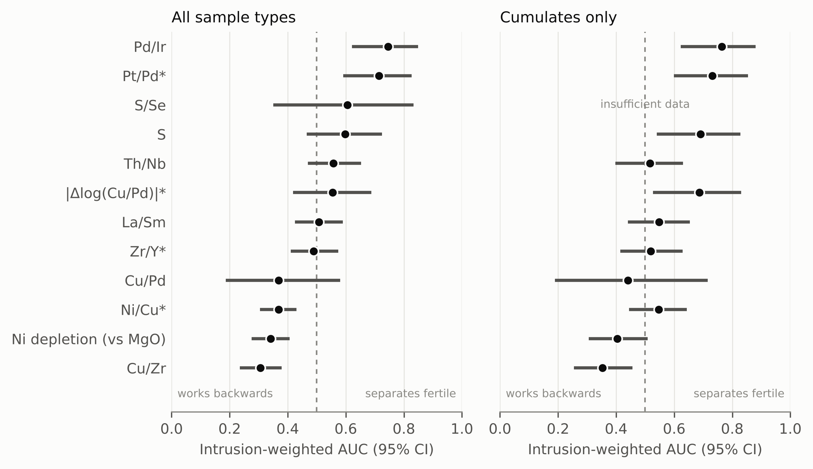

# Fertile or Barren

**Status: v0.1.2 (5 November 2026). Preprint: EarthArXiv, [doi:10.31223/X5M23T](https://doi.org/10.31223/X5M23T) (not peer reviewed; PDF also in [paper/preprint/](paper/preprint/Danso_et_al_2026_Fertile_or_Barren_preprint.pdf)). Data and code DOI: [10.5281/zenodo.23987170](https://doi.org/10.5281/zenodo.23987170); all versions: [10.5281/zenodo.23777405](https://doi.org/10.5281/zenodo.23777405).**

An open benchmark for testing geochemical fertility indices for magmatic Ni-Cu-PGE sulfide deposits. The benchmark contains 13,025 whole-rock analyses from 514 mafic-ultramafic intrusions labeled fertile, weakly mineralized, or barren, together with sample-type classifications, a reproducible scoring workflow, and a public leaderboard.

<!-- HEADLINE:START -->
**Headline numbers (from paper/stats.json):** 13,025 samples from 514 intrusions (34 fertile, 19 weakly mineralized, 461 barren). Best index: Pd/Ir, AUC 0.75 (95% CI 0.62-0.85). 3 indices rank barren intrusions above fertile ones (Ni/Cu, Ni depletion (vs MgO), Cu/Zr). Full table: [leaderboard/LEADERBOARD.md](leaderboard/LEADERBOARD.md).
<!-- HEADLINE:END -->



## What is in this repository

| Path | What it is |
|---|---|
| `data/processed/benchmark_samples.csv` | The benchmark: one row per rock analysis, with intrusion, label, sample type, split and up to 96 element columns |
| `data/processed/intrusions.csv` | One row per intrusion: label, confidence, evidence, location, sample-type counts |
| `data/curated/` | The authors' curated intrusion labels (with references) and name aliases |
| `code/score.py` | **The public scoring program** |
| `code/indices.py` | Definitions of the published indices |
| `leaderboard/LEADERBOARD.md` | The results table; `results.csv` has every number |
| `paper/` | The preprint (`preprint/`), figures (`figures/`, PNG 300 dpi, PDF, SVG), tables (`tables/`, CSV and Excel), captions and `stats.json` |
| `docs/` | Codebook, scoring rules, limitations, next steps, verification record, and the review files behind the labels |

## Score your own method

```bash
pip install -r requirements.txt
# your_scores.csv has two columns: UNIQUE_ID,score  (higher = more likely fertile)
python code/score.py --submission your_scores.csv              # zero-parameter indices
python code/score.py --submission your_scores.csv --split test # anything fitted on this benchmark
```

See [docs/SCORING.md](docs/SCORING.md) and [leaderboard/SUBMITTING.md](leaderboard/SUBMITTING.md).

## Rebuild everything from the public sources

```bash
pip install -r requirements.txt
./run_all.sh          # about 20 minutes the first time (downloads about 500 MB from GEOROC)
```

The run should end with `Done.` and `data/processed/qa_report.txt` should show no `[FAIL]` lines.

## Sources

| Source | Version | License |
|---|---|---|
| GEOROC Compilations, DIGIS Team, GRO.data: 10 tectonic-setting compilations ([Archaean Cratons](https://doi.org/10.25625/1KRR1P) and others; DOIs in `code/01_fetch.py`) plus Rock Types ([10.25625/2JETOA](https://doi.org/10.25625/2JETOA)) as a cross-check | September 2026 release (v13.0; Rock Types v15.0) | CC BY-SA 4.0 |
| USGS Critical Mineral Deposits of the United States | ver. 3.0, September 2026, [10.5066/P9K1HBNT](https://doi.org/10.5066/P9K1HBNT) | CC0 |
| USGS magmatic Ni-Cu-PGE inventory | 2026, [10.5066/P1YLGLUZ](https://doi.org/10.5066/P1YLGLUZ) | CC0 |
| USGS Mineral Resources Data System (MRDS) | full CSV export, [mrdata.usgs.gov/mrds](https://mrdata.usgs.gov/mrds/) | Public domain |

Every downloaded file, its size and SHA-256 fingerprint are in `data/raw/PROVENANCE.txt`.

## Limitations

Read [docs/LIMITATIONS.md](docs/LIMITATIONS.md) before using the labels. Most importantly: "barren" usually means "no deposit on record", not "explored and found empty".

## License

Code: MIT ([LICENSE](LICENSE)). Data: CC BY-SA 4.0 ([LICENSE-DATA](LICENSE-DATA)), as required by GEOROC. Paper and figures: CC BY 4.0.

## Citation

See [CITATION.cff](CITATION.cff). DOI for this version: [10.5281/zenodo.23987170](https://doi.org/10.5281/zenodo.23987170); DOI for all versions: [10.5281/zenodo.23777405](https://doi.org/10.5281/zenodo.23777405).

Preprint: Danso, B.K., Dankwa, J.O., Aidoo, A.A. (2026). Fertile or Barren: an open benchmark for testing geochemical fertility indices on mineralized and barren mafic-ultramafic intrusions. EarthArXiv (not peer reviewed). https://doi.org/10.31223/X5M23T

## Version history

- v0.1.2 (5 November 2026): adds the EarthArXiv DOI of the preprint (10.31223/X5M23T); final preprint PDF; Figure 1b redrawn so all labels sit inside the frame. Data, labels and scores are unchanged from v0.1.0.
- v0.1.1 (30 October 2026): adds the preprint and Figure 1b (benchmark intrusions in the conterminous United States, with USGS deposits). Data, labels and scores are unchanged from v0.1.0.
- v0.1.0 (29 October 2026): first release.

## Authors

Bezali Kwame Danso (corresponding; ORCID 0009-0006-1201-4129), Josephine Opare Dankwa (ORCID 0009-0000-6105-1213), Adwoa Aduaba Aidoo (ORCID 0009-0000-4363-8651). Independent researchers. Contact: dansobez@msu.edu.
